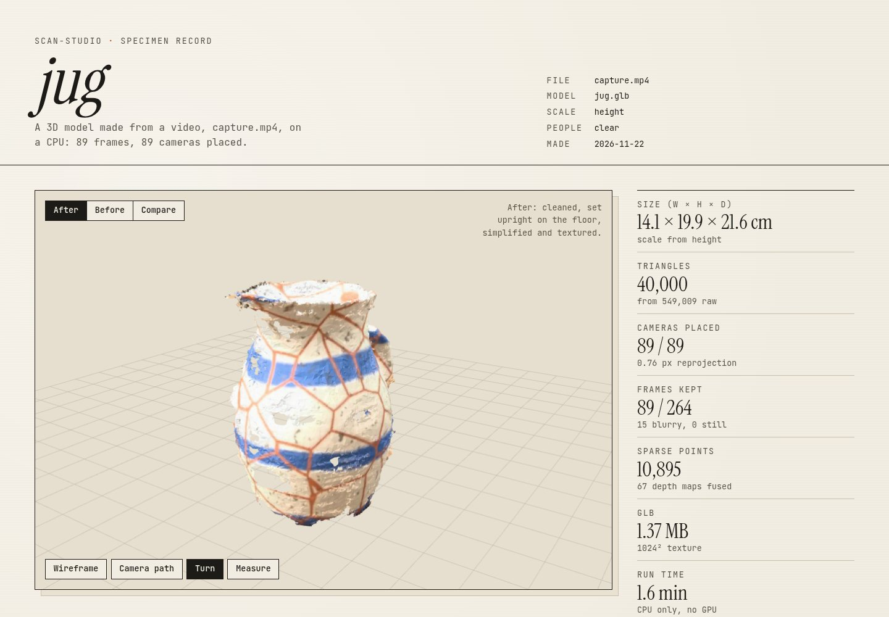

<p align="center"></p>

# scan-studio

[](https://github.com/VinVirtual/scan-studio/actions/workflows/test.yml) [](LICENSE)

A phone video of an object becomes a 3D model for the web and AR, on an ordinary computer with no GPU.

You walk round the object filming it. scan-studio picks the sharp frames, works out where the camera was for each one, builds the surface, cuts away the table, stands the model upright at its real size, simplifies and textures it, and writes a **GLB** (for the web and Android AR) plus one HTML page that shows the model before and after cleaning, lets you measure it, and reports every stage. With the [ar-models](https://github.com/VinVirtual/ar-models) skill installed it also makes the **USDZ** for iPhone AR.

**Objects only, never people.** Every capture is checked for faces, and a capture with people in it is refused.

It is a [Claude Code](https://claude.com/claude-code) skill (`SKILL.md` tells the assistant how to use it) and works by hand from the command line.

Demo: [`docs/turntable.mp4`](docs/turntable.mp4) (the finished model), [`examples/jug/capture.mp4`](examples/jug/capture.mp4) (the input video), [`examples/jug/jug-out/report.html`](examples/jug/jug-out/report.html) (the report; download and open it), [`docs/compare.jpg`](docs/compare.jpg) (before and after cleaning).

## The example: a painted jug, measured against the truth

There is no phone on the machine this was built on, so the input is made the honest way: [`examples/jug/make_capture.py`](examples/jug/make_capture.py) builds a 20 cm painted jug in Blender (lathed body, pinched spout, strap handle, procedural glaze), stands it on a wooden table, and renders an 11 second, 24 fps, 1280x720 hand-held orbit: a 26 mm phone lens, a walk of 1.15 turns that rises from 18 to 44 degrees, hand tremor, roll, four quick jerks and motion blur. Because the jug was made in code, its true shape and the true camera path are known (`ground_truth.ply`, `cameras_gt.json`). Rendering took 48 minutes of CPU; it is committed as [`capture.mp4`](examples/jug/capture.mp4) (2.5 MB) so nobody has to render it again.

`examples/jug/run.sh` then runs, on 8 CPU threads of a 16-thread machine with other jobs running:

```bash
scan-studio run capture.mp4 --out jug-out --name jug --height 0.1995 --texture 1024 --triangles 40000 --usdz
scan-studio evaluate jug-out --truth ground_truth.ply --cameras cameras_gt.json --threshold-mm 2
```

| Stage | Result | Time |
|---|---|---|
| frames | 89 of 264 kept, 15 rejected as blurry (the four jerks) | 2.3 s |
| people check | no faces in 89 frames | 4.7 s |
| structure from motion | 89 of 89 cameras placed, 10,895 points, 0.76 px reprojection error | 40.1 s |
| dense | 67 depth maps fused (TSDF, 7.4 mm voxels at real scale); 549,009 raw triangles | 15.7 s |
| clean, orient, scale | table plane found and removed; 382,469 triangles kept | 0.6 s |
| simplify and texture | 40,000 triangles, 1024x1024 JPEG texture, 89 % of texels coloured from frames | 31.3 s |
| GLB, report, USDZ | `jug.glb` 1.4 MB, `report.html` 4.1 MB, `ar/jug.usdz` 5.1 MB | 1.6 s |
| **total** | | **96 s** |

**Accuracy against the ground truth** (from `report.json`; the base that stood on the table is left out of the truth):

| | |
|---|---|
| mean surface distance (both ways) | **1.83 mm**, 0.59 % of the jug's size |
| median / 95th percentile | 1.49 mm / 4.56 mm |
| F-score at 2 mm | 0.69 (precision 0.71, recall 0.68) |
| height | 198.9 mm (true 199.5 mm; the height was given as 199.5 mm and simplifying moved the top) |
| camera centres after alignment | 6.9 mm mean error |

Alignment uses only the cameras (rotation and translation, no rescaling), then rigid ICP. Before ICP the mean distance is 2.26 mm. Repeated runs vary a little because structure from motion is multithreaded: two runs with exactly these settings gave 1.83 and 1.87 mm. The model is 1.5 cm longer than the real jug (21.6 cm against 20.1 cm, spout to handle) because a thin fin of stereo error at the rim survives cleaning.

Committed outputs: [`jug-out/jug.glb`](examples/jug/jug-out/jug.glb), [`jug-out/report.html`](examples/jug/jug-out/report.html), [`jug-out/report.json`](examples/jug/jug-out/report.json). The USDZ pair in `jug-out/ar/` is not committed (6.9 MB); `run.sh` makes it in under two seconds once ar-models is installed.

## Install

```bash
git clone https://github.com/VinVirtual/scan-studio ~/.claude/skills/scan-studio
cd ~/.claude/skills/scan-studio
python3.12 -m venv .venv && .venv/bin/pip install -r requirements.txt   # or: uv venv --python 3.12 .venv && uv pip install --python .venv/bin/python -r requirements.txt
./scan-studio check
```

Python 3.12 (Open3D 0.19 has no wheels for 3.13 yet). Linux tested. Node.js and Playwright are only needed for `render` (screenshots of the report); Node.js and the ar-models skill only for `--usdz`.

## Quick start

```bash
S=~/.claude/skills/scan-studio
$S/scan-studio run my-mug.mp4 --height 0.105            # the real height in metres
$S/scan-studio run photos/ --longest 0.32 --usdz         # a folder of photos; also make the iPhone file
$S/scan-studio scale my-mug-out --points "0.01,0.09,0.02" "0.01,0.00,0.02" --length 0.095   # fix the size later
```

Output, in `<name>-out/` next to the input:

| File | What |
|---|---|
| `<name>.glb` | the model: metres, +Y up, base on the floor, centred, textured |
| `report.html` | one file, no network: before/after/compare 3D view, Measure tool, blur chart, timings, people check |
| `report.json` | every number in the report |
| `ar/<name>.glb`, `ar/<name>.usdz` | with `--usdz`: the AR pair from ar-models |
| `work/` | the chosen frames, the COLMAP database and the sparse model (`work/sparse/*.txt`) |

## How to film

Walk slowly all the way round, phone upright, ideally twice (once at table height, once looking down). Keep the whole object in frame. Soft light, no flash. Stand it on something with texture (newspaper, wood), not on plain white. Shiny, transparent, black or featureless objects will not reconstruct well with any photogrammetry, this one included.

## How it works

1. **Frames.** ffmpeg decodes up to 600 evenly spaced candidates (capped in total pixels). Each gets a blur score (variance of the Laplacian at a fixed width). The capture is cut into equal parts (90 by default) and the sharpest frame of each part is kept, unless it is blurry *for its neighbourhood* (below 45 % of the local median, so a dim but steady video is not thrown away) or the camera had not moved.
2. **People check.** OpenCV's Haar face detectors (frontal and profile) run on every kept frame. Faces in at least 2 frames (or 5 %) stop the run with exit code 4 and the extracted frames are deleted. A single hit is a warning in the report.
3. **Structure from motion.** pycolmap (COLMAP's Python package) on the CPU: SIFT features, matching of each frame against its 12 neighbours plus a coarse all-against-all grid (so the end of the orbit ties back to the start), incremental mapping with one shared camera.
4. **Dense surface.** COLMAP's own dense stereo needs CUDA (`pycolmap.patch_match_stereo` stops with "requires CUDA or HIP" here), so scan-studio pairs each frame with a neighbour 3 to 16 degrees away, rectifies the pair with the solved poses, and runs OpenCV semi-global block matching with a left-right check. Depth next to silhouettes is dropped, then each depth pixel must agree with at least two neighbouring depth maps. The depth maps are fused in an Open3D TSDF volume sized to the object (fitted to the sparse points standing on the ground plane), and marching cubes gives a coloured mesh. If stereo fails, a Poisson surface through the sparse points is the fallback.
5. **Clean.** The ground plane is found by RANSAC (its normal must agree with the camera-derived up and the cameras must be above it) and everything under it is removed; faces far from any matched feature (stereo fins along silhouettes) go; the largest connected piece is kept. `--box` crops to a box in output metres.
6. **Orient.** Up is the direction most perpendicular to every camera's right axis (people hold phones level), signed by the cameras' up axes, then refined to the ground-plane normal. The side seen in the first frame faces +Z (the front in glTF viewers). The base is put on y = 0.
7. **Scale.** `--height`, `--longest`, `--width`, or two picked points and their real distance (`--points` with `--length`). Without one the model keeps COLMAP's arbitrary units and no USDZ is made.
8. **Simplify and texture.** Quadric decimation (Open3D) to the triangle budget, UV atlas with xatlas, and each texel coloured from up to three frames that see its triangle most squarely, after a ray test that it is not hidden. Texels no frame sees take the nearest dense colour.
9. **Write.** GLB (trimesh), checked by reading it back (header, chunks, every accessor inside its buffer). Then `report.json` and `report.html`.

## Commands

| Command | What it does |
|---|---|
| `scan-studio run <video or folder> [options]` | the whole pipeline; `--help` lists everything |
| `scan-studio scale <out> --height M` / `--points P1 P2 --length M` | set the real size of a finished run (seconds, no reconstruction) |
| `scan-studio render <out>/report.html --png a.png [--mode before\|compare] [--mp4 t.mp4]` | screenshots or a turntable video of the report, in headless Chrome |
| `scan-studio evaluate <out> --truth mesh.ply --cameras cams.json` | measure a test capture against its ground truth |
| `scan-studio faces <video\|folder\|image>` | only the people check |
| `scan-studio frames <video>` | only the frame choice, with the blur scores |
| `scan-studio report <out>` | write `report.html` again |
| `scan-studio check` / `env` / `test` | environment check / packages / test suite |

Main `run` options: `--height`/`--longest`/`--width` or `--points` + `--length`, `--frames 90`, `--triangles 80000`, `--texture 2048` (0 = vertex colours), `--box`, `--keep-ground`, `--dense auto|stereo|sparse`, `--threads 8`, `--usdz`, `--confirm-object` (only for faces that belong to an object, such as a statue; never for a person).

Exit codes: 0 done, 1 the capture could not become a model, 2 a usage mistake, 3 over a size limit, 4 people found, 5 internal error.

## Safety

- **People.** The tool refuses captures with faces and says so. The face check is a guard, not a guarantee (Haar detectors miss turned or small faces and can fire on face-like patterns). Do not use it on people.
- **Inputs.** Local files only. ffmpeg runs with `-protocol_whitelist file,pipe`. Photo folders skip symlinks that point outside the folder. Budgets cap totals, not just items: input bytes, number of photos, pixels per photo (checked before decoding), decoded candidate frames and their total pixels, kept frames, triangles, texture size and report size.
- **Outputs.** Written to a temporary file and renamed into place; output files or folders that are symbolic links are refused.
- **The report.** Content security policy `default-src 'none'`, with only its own inline script and style allowed by SHA-256 hash: no network requests, no other scripts. Every input name is escaped; the data block cannot close its `<script>` element.
- **Python.** The launcher runs Python with `-I` (no current folder, no `PYTHONPATH`, no user site-packages on the import path); `check_env.sh` probes from `/`.

## Limits

- **CPU only, by design.** The dense step is two-view stereo, not COLMAP's multi-view PatchMatch (CUDA only) or OpenMVS (not installable here without root). Surfaces come out smoother and less detailed than GPU photogrammetry; thin parts may be lost or thickened, and concave insides (the inside of a jug) are partial.
- **No Gaussian splats.** No splat trainer runs in reasonable time on a CPU (the CPU mode of OpenSplat exists but takes hours for a small scene and is AGPL). The solved cameras and points are in `work/sparse/` in COLMAP's text format, ready for a GPU splat tool.
- **The face check can fire on patterns.** OpenCV's default frontal and profile Haar models fired on the demo jug's painted pattern (7 of 89 frames, which would have refused it), so they now need 15 overlapping detections and the more precise `alt2` frontal model needs 6. With these settings 1 of the 264 rendered frames still triggers it, which is a warning, not a refusal. Busy prints on a real object may need `--confirm-object` after you have looked at the frames.
- **The base is open** where the object stood on the table.
- **Real-world captures were not tested here** (no phone on this machine). The demo is a rendered video with simulated hand shake and motion blur; real phone video adds rolling shutter, exposure changes and compression, which usually cost some accuracy.
- **Runtime** depends on the machine and its load; see the example for measured numbers.

## Tests

`./scan-studio test` runs 162 tests: frame scoring and selection, the people check (on faces drawn with ellipses, never a photograph), scaling maths, orientation, ground plane, cleaning, stereo helpers, texture baking, GLB writing and validation (including corrupt files), path safety, budgets, report escaping and CSP, the ar-models hand-off, the command line, and the whole pipeline end to end on 19 small frames of the demo. CI runs all of them on GitHub's Ubuntu runner, and a skipped test fails the run. Not tested in CI: Blender (only to remake the demo) and the headless-Chrome screenshots.

## Licence

MIT, see [LICENSE](LICENSE). Bundled third-party files (three.js, two fonts) and their licences are listed in [ASSETS.md](ASSETS.md).
